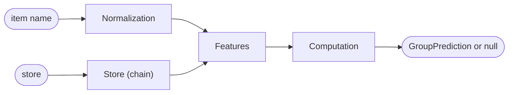

# Interface

The binding specification for the Python implementation (`src/pgm/`) and the Kotlin implementation in the app.

> [!IMPORTANT]
> If this file contradicts the code, **this file wins** and the code is adjusted.
> Both implementations must match the golden values under `tests/golden/` exactly ([README](../README.md#golden-value-tests)).

## Overview

How a receipt line becomes a prediction, one section per step:



| Section | Python | Kotlin | Golden values |
|---|---|---|---|
| [Input and output](#input-and-output) | – | `ProductGroupModel.kt` | – |
| [Normalization](#normalization) | `pgm/normalize.py` | `Normalize.kt` | `normalize.tsv` |
| [Features](#features) | `pgm/features.py` | `Features.kt` | `features.tsv` |
| [Store](#store) | `pgm/stores.py` | `ProductGroupModel.chainOf` | `tiny.tsv` |
| [Computation](#computation) | `pgm.export.probabilities` | `ProductGroupModel.probabilities` | `tiny.tsv`, `dist/*.golden.tsv` |
| [File format](#file-format) | `pgm/export.py` | `ProductGroupModel.load` | `tiny.bin` |
| [Versions and file names](#versions-and-file-names) | `pgm.export.model_version`, `file_name` | – | – |

## Input and output

Reference: [`kotlin/reference/src/main/kotlin/pgm/ProductGroupModel.kt`](../kotlin/reference/src/main/kotlin/pgm/ProductGroupModel.kt).

```kotlin
data class GroupPrediction(
    val classId: String,     // fine class of the model, e.g. "pflanzendrinks" (mapping/classes.yaml)
    val groupId: String,     // ItemGroup.id of the app, e.g. "dairy" (mapping/groups.yaml)
    val confidence: Float,   // 0..1, probability of the best class
    val level: Level,
)

enum class Level { SURE, SUGGESTION }

class ProductGroupModel {
    val version: String
    /** null if the confidence is below the suggestion threshold or the name has no features */
    fun classify(itemName: String, store: String? = null): GroupPrediction?
    /** The k most likely classes, descending */
    fun topK(itemName: String, store: String? = null, k: Int = 3): List<Pair<String, Float>>
    companion object { fun load(data: ByteArray): ProductGroupModel }
}
```

| Parameter | Meaning |
|---|---|
| `itemName` | The item name of a receipt line, as the app's parser delivers it. Price, tax marker and item number are already removed. |
| `store` | Name of the merchant as the app knows it (e.g. `"REWE Markt GmbH"`), or `null`. The model detects the chain from it ([Store](#store)). |

- The model predicts fine classes; the app's group for each class is stored in the model file. `deposit` stays a rule in the app, `other` is only chosen by the user.
- Uncertain cases return `null`, and the next source takes over.
- Order in `ItemGroupClassifier`:

  ```
  RULE → PRODUCT → WORDS → MODEL (from t_suggest) → DICTIONARY → MERCHANT
  ```

  On real receipts the model does better before the dictionary than after it ([README](../README.md#results-so-far)).

## Normalization

Implementation: [`src/pgm/normalize.py`](../src/pgm/normalize.py), golden values: [`tests/golden/normalize.tsv`](../tests/golden/normalize.tsv).

Steps in **exactly this order**:

| # | Step | Example |
|---|---|---|
| 1 | Unicode normal form **NFKC**: full-width characters, ligatures and similar variants become plain characters. | `fi` → `fi`, `Ａ` → `A` |
| 2 | Replace according to the table, upper and lower case:<br>`ä→ae ö→oe ü→ue ß→ss ẞ→SS æ→ae œ→oe ø→o` (and the upper-case letters accordingly: `Ä→AE` etc.) | `Müller` → `Mueller` |
| 3 | Unicode normal form **NFKD** and remove all characters of category *Mn* (non-spacing marks). | `é` → `e`, `İ` → `I` |
| 4 | Convert **only** `a`–`z` to `A`–`Z`. No `uppercase()` with a locale, because Java and Python differ in special cases. | `Mueller` → `MUELLER` |
| 5 | Replace every character except `A–Z 0–9 % , . - ! &` and the space with a space. | `H-MILCH/1L` → `H-MILCH 1L` |
| 6 | Collapse runs of spaces into one and remove spaces at the start and end. | `␣BIO␣␣MILCH␣` → `BIO MILCH` |

The result consists of ASCII characters only. So lengths and indices are the same in Python (code points) and Kotlin (UTF-16), which matters for the character n-grams.

> [!NOTE]
> **Kotlin:** `java.text.Normalizer.normalize(s, Normalizer.Form.NFKC)`, accents via `Character.getType(c) == Character.NON_SPACING_MARK`.
> Characters outside the BMP (e.g. emoji) become a space in step 5. If Kotlin iterates over `Char` instead of code points, two spaces result, which step 6 collapses again. So the result is the same, but iterating over code points is still cleaner.

## Features

Implementation: [`src/pgm/features.py`](../src/pgm/features.py), golden values: [`tests/golden/features.tsv`](../tests/golden/features.tsv).

### Tokens

The normalized name is split into tokens at spaces. Left out are:

| Left out | Why |
|---|---|
| tokens that consist only of `0–9 , . % -` | numbers, prices, weights |
| `X KG G L ML EUR ST STK STUECK AW A B` | units, price and tax markers that the receipt parser leaves on the name, e.g. `BANANE 0, 750 kg x 1,79 EUR/kg` |

Quantities with the unit in one word, like `500G`, stay.

### Features in this order

1. For each token `T`:
   - the word `<T>`
   - all substrings of `<T>` of length `minn`…`maxn` (first all of length `minn` from left to right, then `minn+1` …), **except** the whole word `<T>` itself
2. If `bigrams`: for each adjacent token pair `"T1 T2"` (with one space)
3. If `store` and a store is given and the name has at least one token: `__store=` + normalized store

Example with `minn = maxn = 4` and no word pairs or store, for `MILCH`:

```
<MILCH>  <MIL  MILC  ILCH  LCH>
```

- Duplicate features are kept (they count multiple times when averaging).
- A name without tokens has no features, and `classify` then returns `null`.
- The parameters (`buckets`, `minn`, `maxn`, `bigrams`, `store`) are stored in the model file and not fixed in the code.

### Hashing

Bucket of a feature: `fnv1a32(utf8(feature)) mod buckets`.

```
FNV-1a, 32 bit
h = 0x811C9DC5                              offset basis
for each byte:  h = (h xor byte) * 0x01000193 mod 2^32
```

> [!NOTE]
> **Kotlin:** compute with `UInt` or with `Long` masked by `and 0xFFFFFFFFL`. The byte goes in **unsigned** (`b.toInt() and 0xFF`).

## Store

The model file contains the chains and their aliases from `mapping/stores.yaml` (aliases normalized, `-` as a space, longest first, alphabetical for equal length).

1. `text = normalize(store with "-" replaced by " ")`
2. The first alias that is a word of `text`, equals `text`, or that `text` starts with (`text.startsWith(alias + " ")`) determines the chain.
3. Otherwise no chain, hence no store feature.

The chain goes in as a feature, e.g. `"REWE Markt GmbH"` → chain `REWE` → `__store=REWE`.

## Computation

Reference in Python: `pgm.export.probabilities`; in Kotlin: `ProductGroupModel.probabilities`. Everything in `Float32`, in this order:

| # | Step | Formula |
|---|---|---|
| 1 | Feature IDs ([Features](#features)) with the chain as the store. Empty → `null`. | `ids` |
| 2 | Average the feature vectors over the features in their order. `embedding` is `int8`, the product is formed as `Float32`. | `h[d] = Σ_i (embedding[id_i][d] × scale[id_i])`, then `h[d] /= number of features` |
| 3 | Scores per class, divided by the temperature. | `z[k] = (bias[k] + Σ_d output[k][d] × h[d]) / T` |
| 4 | Softmax. | `p[k] = exp(z[k] − max z) / Σ exp(z − max z)` |
| 5 | Best class = largest `p`, on a tie the lower class number. | `SURE` from `t_sure`, `SUGGESTION` from `t_suggest`, otherwise `null` |

> [!NOTE]
> Differences between Python and Kotlin due to summation order are below `1e-5`. The golden values check the probabilities with this tolerance, and the order of the best classes when they are more than `1e-4` apart.

## File format

Implementation: [`src/pgm/export.py`](../src/pgm/export.py) (write, read) and `ProductGroupModel.load` (Kotlin).
All numbers little endian; `str8`/`str16` = length as `u8`/`u16`, then UTF-8.

| Field | Type | Content |
|---|---|---|
| **Header** | | |
| magic | 4 bytes | `PGM1` |
| format | u16 | Version of the format **and of the rules for normalization and features**, currently 2 (see below) |
| version | str16 | Model version `<market>-<release>`, e.g. `de-DE-2026.10.1` ([Versions](#versions-and-file-names)) |
| created | i64 | Unix time in seconds |
| **Parameters** | | |
| buckets | u32 | Number of feature rows |
| dim | u16 | Length of a feature vector |
| minn, maxn | u8, u8 | Length of the character n-grams |
| flags | u16 | Bit 0: word pairs, bit 1: store feature |
| temperature | f32 | Temperature `T` |
| t_sure, t_suggest | f32, f32 | Thresholds for `SURE` and `SUGGESTION` |
| **Classes and chains** | | |
| n_labels | u16 | Number of classes |
| labels | n_labels × (str8, str8) | Class and app group |
| n_chains | u16 | Number of chains |
| chains | n_chains × str8 | Chain names (normalized) |
| n_aliases | u16 | Number of aliases |
| aliases | n_aliases × (str8, u16) | Alias (normalized) and index of the chain |
| **Weights** | | |
| scales | buckets × f32 | Scale per feature row |
| embedding | buckets × dim × i8 | Feature vectors, value = q × scale |
| output | n_labels × dim × f32 | Output matrix, row by row per class |
| bias | n_labels × f32 | Bias per class |
| **Check** | | |
| crc32 | u32 | CRC-32 (like `java.util.zip.CRC32`) over all preceding bytes |

Size with 2^16 buckets, dim 24 and 46 classes: **1.84 MB**.

> [!IMPORTANT]
> **`format`** covers the rules for normalization and features too. If a rule changes, the version goes up, and old models are rejected instead of being computed wrongly.
> History: 1 → 2: numbers and units no longer become features.

## Versions and file names

```
pgm-f2-de-DE-2026.10.1.bin
    │  │     │       └ sequence number within the month, optionally -rc1, -rc2 … for candidates
    │  │     └ month of the data snapshot (raw data per data/raw/MANIFEST.json), not of the build
    │  └ market as language-country (BCP 47): chains, private labels and abbreviations depend on the country
    └ format field: only models in the format known to the app's Kotlin files can be loaded
```

| Name | Form | Example | Used for |
|---|---|---|---|
| Model version | `<market>-<release>` | `de-DE-2026.10.1` | header of the file; appears in the app's notice |
| File name | `pgm-f<format>-<modelversion>.bin` | `pgm-f2-de-DE-2026.10.1.bin` | an app that loads format 2 takes the newest `pgm-f2-<market>-*.bin` |
| Git tag | `model-<modelversion>` | `model-de-DE-2026.10.1` | one per shipped model |

- `scripts/export.py --market de-DE --release 2026.10.1` builds both names (`pgm.export.model_version`, `pgm.export.file_name`) and rejects deviations from the scheme.
- Retrained, new thresholds or new classes: only the **release number** goes up.
- New rules for normalization or features: **`format`** goes up (and with it the file name).
- A shared model for several markets gets its own market identifier; it will be decided when the time comes.
